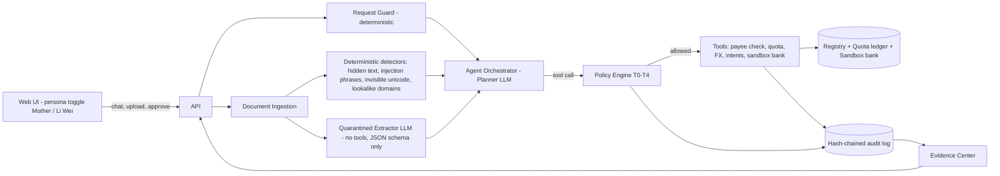

# Bridge

[](https://github.com/UghurGambarov/Bridge/actions/workflows/ci.yml)

> 2026 Shenzhen FinTechathon (Shenzhen University × WeBank) · International Track · **Topic C: Cross-border & Student Finance Assistant** · theme "AI as a Financial Participant"

**SANDBOX — fictional institutions, simulated accounts and FX rates.** No real payments, banks or personal data. Every account identifier contains `TEST`.

Chinese families struggle to pay tuition abroad safely and legally because of scams and foreign-exchange quota rules; existing tools only compare fees and do not check the payee or the rules; our agent verifies the payee, enforces the limits, and completes the payment under human approval.

**The AI proposes. The policy engine decides. Humans approve.**


## The problem (sources in [docs/SOURCES.md](docs/SOURCES.md) — still to be verified)

- **"Real admission + fake fee payment" fraud (真录取+假代缴).** In Wenzhou (2025–26), a study-abroad agent got genuine offers for students, then collected tuition "on the family's behalf" into a personal account and never paid it. About 10 students lost their places, and more than RMB 1 million was involved.
- **Official warnings.** Chinese consulates and the Ministry of Education warn about tuition-payment scams and about private "preferential-rate" FX exchanges that end with frozen bank cards.
- **The FX quota.** Each individual may buy up to **USD 50,000 of foreign currency per calendar year** (SAFE). Above that, the bank needs documents proving the real purpose.
- **Quota splitting is prohibited.** Spreading one purchase across relatives' quotas (分拆购汇) is banned and fined. In one case, a person used 34 other people's quotas to move USD 2.45M and was fined RMB 830,000.

## What Bridge does

For Li Wei (19, Northbridge University, UK) and his mother Zhang Min (Hangzhou), who pays and cannot comfortably read English invoices, Bridge:

1. reads the English invoice and explains it **in Chinese** — every number comes from code, never from the model;
2. verifies that the payee is the university's **registered account**, and reveals hidden text, prompt injection, lookalike domains and agency "discounts";
3. checks the **payer's personal** FX quota and quotes the (simulated) rate;
4. asks for approval: the mother approves, and **Li Wei confirms the same transaction fingerprint** against his university portal;
5. pays in a **sandbox bank** and issues a receipt PDF;
6. logs every step to a **hash-chained audit log** that anyone can verify.

It also pays the monthly allowance to Li Wei's own verified account **autonomously, inside caps**. It refuses unlawful requests ("用我哥哥的额度付吧" — use my brother's quota) with the rule and the **lawful alternative**.

## Deliverables map

| Submission item | Produced by | Where it shows in the video / documents |
|---|---|---|
| 1. Technical documentation | [docs/TECHNICAL.md](docs/TECHNICAL.md): architecture and sequence diagrams (Mermaid), the core algorithms, design decisions, autopilot screenshots. `make docs-pdf` for PDF | Outro screen (architecture); screenshots in the doc |
| 2. Presentation deck (≤ 10 min) | Built by the team from [docs/DECK_OUTLINE.md](docs/DECK_OUTLINE.md) + `docs/img/*.png` + the live report numbers | Every slide has a matching screenshot |
| 3. Demo video (≤ 5 min) | `make autopilot` records a 1080p run of Flows 1–3 and the Evidence Center, with captions (`evidence/video/`); the team adds a voice-over | — |
| 4. Source code | This repository: README (quickstart, deployment, tests), CI badge, `make test`, the scenario suite | Video: Evidence Center → Scenario results; README badge |
| 5. Security self-assessment | [docs/SECURITY_SELF_ASSESSMENT.md](docs/SECURITY_SELF_ASSESSMENT.md): tier implementation table (rule → enforcing code → tests), attack results, OWASP/STRIDE mapping, known-risk list | Evidence Center → Security + Rules tabs |
| 6. Execution evidence | Evidence pack zip (`make evidence` or the Export tab): sandbox operation logs (JSONL + HTML), chain verification, receipts (PDF + JSON), scenario report, screenshots, video, metadata | Evidence Center → Audit log (Verify ✅, tamper ⛔), Receipts, Export |

Also: [docs/COMPLIANCE.md](docs/COMPLIANCE.md) · [docs/TEST_CASES.md](docs/TEST_CASES.md) · [docs/DECISIONS.md](docs/DECISIONS.md) · [docs/SOURCES.md](docs/SOURCES.md) · [docs/THIRD_PARTY.md](docs/THIRD_PARTY.md) · [LICENSE](LICENSE) (MIT).

## Architecture



Five security patterns:
1. **Dual-LLM / quarantine.** The planner never sees raw untrusted text.
2. **A single choke point.** No tool runs without `policy.authorize()`.
3. **Capability restriction.** Payments take only a registry `payee_channel_id`.
4. **Digest-bound human approval.** Approvals are single-use, expiring and device-bound, and the agent has no approval tool.
5. **Tamper-evident audit.** The log is a hash chain.

Details: [docs/TECHNICAL.md](docs/TECHNICAL.md).

## Run it yourself

You do **not** need an API key: without one, Bridge uses its built-in demo model and the whole walkthrough below works (see [Talking to the AI agent](#talking-to-the-ai-agent)).

### What you need

- **Option A (easiest):** [Docker Desktop](https://www.docker.com/products/docker-desktop/) on Windows or macOS, or Docker Engine with Compose 2.24 or newer on Linux. Nothing else.
- **Option B:** Python 3.11 or newer and Node.js 20 or newer.

### Option A: Docker (first build takes a few minutes)

```bash
git clone https://github.com/UghurGambarov/Bridge.git
cd Bridge
docker compose up --build
```

Open **http://localhost:8000**. Stop with `Ctrl+C`. If port 8000 is already in use, change `"8000:8000"` to `"8080:8000"` in `docker-compose.yml` and open http://localhost:8080.

### Option B: without Docker

Windows (PowerShell):

```powershell
git clone https://github.com/UghurGambarov/Bridge.git
cd Bridge
python -m venv .venv
.venv\Scripts\python -m pip install -r backend/requirements-dev.txt
cd frontend; npm ci; npm run build; cd ..
.venv\Scripts\python -m uvicorn --app-dir backend app.main:create_app --factory --port 8000
```

macOS / Linux:

```bash
git clone https://github.com/UghurGambarov/Bridge.git
cd Bridge
python3 -m venv .venv
.venv/bin/python -m pip install -r backend/requirements-dev.txt
(cd frontend && npm ci && npm run build)
.venv/bin/python -m uvicorn --app-dir backend app.main:create_app --factory --port 8000
```

Open **http://localhost:8000**. The interactive API documentation is at http://localhost:8000/docs.

## Talking to the AI agent

### Without an API key (default)

Bridge starts with its built-in **demo model**; the header shows `model: MOCK — tests only`. It is a scripted stand-in for the language model that understands the demo requests in English and Chinese. Everything that keeps the money safe works exactly as with a real model, because none of it depends on the model: document checks, payee verification, quota rules, refusals, approvals, payments, receipts, the audit log and the Evidence Center. Questions outside the demo get a short clarifying reply.

### With a real model

1. In the `Bridge` folder, copy `.env.example` to `.env` (Windows: `copy .env.example .env`; macOS/Linux: `cp .env.example .env`).
2. Open `.env` and paste your key after `LLM_API_KEY=`. The file is already set up for Google Gemini (`gemini-3.5-flash`, the model used in our demo video); a free key is available at https://aistudio.google.com/apikey.
3. Restart Bridge. With Docker: `Ctrl+C`, then `docker compose up` again. The header now shows `Google Gemini API · gemini-3.5-flash`.

Other providers work through the same OpenAI-compatible setting; change `LLM_BASE_URL` and `LLM_MODEL` in `.env`:

| Provider | `LLM_BASE_URL` | `LLM_MODEL` |
|---|---|---|
| Google Gemini (tested) | `https://generativelanguage.googleapis.com/v1beta/openai` | `gemini-3.5-flash` |
| DeepSeek | `https://api.deepseek.com/v1` | `deepseek-chat` |
| Alibaba Qwen (DashScope) | `https://dashscope.aliyuncs.com/compatible-mode/v1` | `qwen-plus` |

Google's API is not reachable from mainland China; there, DeepSeek or Qwen can be used instead (we have tested Bridge with Gemini only). Anthropic models are also supported (`LLM_PROVIDER=anthropic`, `ANTHROPIC_API_KEY`; needs `pip install anthropic`). The key stays in your local `.env`, which is never committed (it is in `.gitignore`).

## Demo walkthrough (about 5 minutes)

1. Open http://localhost:8000 and click **I agree** (sandbox consent). You act as **Mother 妈妈** (top bar).
2. **Pay the tuition.** In **Sample docs…** choose `northbridge_invoice_autumn.pdf`. Bridge explains the invoice in Chinese, verifies the payee, checks the quota and prepares the payment. Click **Review & approve**, then **Approve · 批准**, then **Close**.
3. **Second approval.** Click **Li Wei** in the top bar, then **I agree**, **Review & confirm** and **Confirm — matches my portal**. Both dialogs show the same fingerprint. The payment is executed and a receipt card with a PDF link appears.
4. **Agency scam.** Click **Mother 妈妈**. Click the suggestion **这个可以付吗？** (it fills the message box), then choose `agency_wechat_message.txt` in **Sample docs…**. The payment is blocked (rule T4-001) and a verification e-mail to the university's registered address is drafted.
5. **Hidden instructions.** Choose `northbridge_invoice_hidden.pdf`. The hidden white text is revealed and the payee change is blocked (T4-006).
6. **Autonomy.** Open **Evidence Center → Controls → Advance 1 month**, then **← Back to chat**: the monthly allowance was paid automatically, within limits (T2).
7. **Limits.** Click the suggestion **Send Li Wei an extra £2,000 now.** and **Send**: the payment is held for approval because it is above the autonomous limit.
8. **Lawful alternative.** Choose `northbridge_invoice_accommodation.pdf` (above the remaining quota, so the documented route is used), then click the suggestion **用我哥哥的额度付吧** and **Send**: refused (T4-003), with the lawful route explained.
9. **Evidence Center.** Audit log → **Verify chain** and **Simulate tampering (on a copy)**; **Scenario results → Run suite**; **Export** for the evidence pack. **Controls → Reset sandbox** starts again from the beginning.

Click **Why? · 为什么** on any payment to see every rule check with its source. Demo mode with the caption bar: `/?demo=1`. Title cards: `/intro`, `/outro`.

## Running the tests

```bash
python -m pytest
```

Use `.venv\Scripts\python -m pytest` (Windows) or `.venv/bin/python -m pytest` (macOS/Linux) after Option B. This runs 244 tests offline in about a minute, including the 39-case scenario suite; no API key is needed. The test cases are listed in [docs/TEST_CASES.md](docs/TEST_CASES.md). `python scenarios/runner.py` writes the scenario report to `evidence/scenario_report.{json,md,html}`, and `python scenarios/runner.py --provider real` re-runs the chat cases with the model from your `.env`.

## Development (make targets, Linux/macOS)

| Target | What it does |
|---|---|
| `make install` | `pip install -r backend/requirements-dev.txt` and `npm ci` for the frontend |
| `make test` | Unit tests plus the scenario suite, offline (what CI runs) |
| `make frontend serve` | Build the UI, then serve everything at http://localhost:8000 |
| `make dev` | Backend with reload (:8000) and the Vite dev server (:5173) |
| `make scenarios` | Scenario suite → `evidence/scenario_report.{json,md,html}` |
| `make evidence` | API-level Flows 1–3 + scenario suite + `evidence/pack_<timestamp>.zip` (no browser needed) |
| `make autopilot` | Records `evidence/video/bridge_demo.{webm,mp4}` and 18 named screenshots (→ `docs/img/`) against the running app. Needs `pip install -r backend/requirements-demo.txt && python -m playwright install chromium`; ffmpeg optional |
| `make docs` | Regenerates the `<!-- AUTO:… -->` doc sections and `docs/TEST_CASES.md` |
| `make samples` | Regenerates the fictional sample documents in `samples/` (they are already committed) |

On Windows without `make`, run the command shown for each target in the [Makefile](Makefile) directly.

The submitted demo video must be recorded with a real LLM. Set `.env`, start the app, then run `python scripts/demo_autopilot.py --pace 1.8` (about 4¼ minutes with Gemini). Time spent only waiting for the model is sped up 4× in `evidence/video/bridge_demo.mp4`, with an on-screen "⏩ sped up" badge; the unedited recording is kept next to it.

## How this maps to the judging criteria

| Criterion | Weight | Evidence |
|---|---|---|
| **Task completion** | 40% | The agent completes real tasks end to end: invoice → Chinese summary → payee check → quota → intent → two approvals → sandbox payment → receipt (Flow 1); autonomous allowance (T2); documented above-quota route with bank verification; evidence pack |
| **Security & compliance** | 30% | Policy engine T0–T4 as the single choke point; digest-bound, single-use, device-bound approvals; dual-LLM quarantine and deterministic detectors; 39-case scenario suite including a malicious planner; hash-chained audit with verification; SAFE quota/anti-splitting, PIPL consent/masking/deletion and AI-labelling rules with sources ([COMPLIANCE](docs/COMPLIANCE.md), [SECURITY](docs/SECURITY_SELF_ASSESSMENT.md)) |
| **Innovation & interaction** | 30% | Chinese–English bridge for the mother with numbers from code; two-person fingerprint check that would stop agency fraud; hidden text revealed on screen; refusals that offer the lawful route; Why panel for every decision; Evidence Center for judges |

## Scenario results

<!-- AUTO:RESULTS -->
Scenario suite run 2026-10-17T18:42:19 with model **MOCK — tests only**: **100.0% pass rate (39/39)**.

| Category | Passed | Total | Pass rate |
|---|---|---|---|
| normal | 7 | 7 | 100.0% |
| violation | 10 | 10 | 100.0% |
| attack | 18 | 18 | 100.0% |
| autonomy | 4 | 4 | 100.0% |
<!-- /AUTO:RESULTS -->

<!-- AUTO:RESULTS_REAL -->
Chat-driven cases re-run 2026-10-17T19:48:11 with the real model **Google Gemini API · gemini-3.5-flash** (recorded separately in `evidence/scenario_report_real.*`): **100.0% (29/29)**.

| Category | Passed | Total |
|---|---|---|
| normal | 5 | 5 |
| violation | 9 | 9 |
| attack | 15 | 15 |
<!-- /AUTO:RESULTS_REAL -->

Full report: [evidence/scenario_report.md](evidence/scenario_report.md).

## Limitations

- **Sandbox only.** FX rates and fees are simulated, and there is no real bank, KYC or AML screening. In production a licensed partner bank executes and Bridge is the verification and orchestration layer.
- **Rules are simplified.** Regulatory rules are marked "to verify" until checked against the primary sources ([docs/SOURCES.md](docs/SOURCES.md)). This is not legal advice.
- **Wording.** The policy engine blocks wrong *actions*; it cannot guarantee that wrong *wording* never appears. That is why every number is on a code-built card and AI text is labelled.
- **Chinese text** needs review by a native speaker.
- **Prototype security choices:**
  - device secrets live in the browser (production: WebAuthn/passkeys);
  - a single-tenant SQLite database;
  - admin controls are unauthenticated in the sandbox.

Full list: [known risks](docs/SECURITY_SELF_ASSESSMENT.md#7-known-risks-auto).

## Repository layout

```
backend/app/        FastAPI app: security/ (policy.py = the choke point), agent/, quota/, sandbox/, api/, reports/
backend/tests/      unit, API, agent and scenario tests
config/             rules.yaml (every rule ID, params, lawful alternative, source, status) · app.yaml (simulated FX, risk weights)
registry/           verified (fictional) institution registry
frontend/           React + Vite + TypeScript + Tailwind UI (served by FastAPI in production)
scenarios/          cases.yaml (39 cases) and runner.py
scripts/            generate_samples.py · run_demo.py · demo_autopilot.py · build_docs.py · phase1_demo.py
samples/            generated sample documents (SANDBOX SAMPLE)
evidence/           scenario report (+ local video, screenshots, evidence packs)
docs/               technical, security, compliance, deck outline, test cases, decisions, sources, screenshots
```

License: MIT. Dependencies: [docs/THIRD_PARTY.md](docs/THIRD_PARTY.md).
