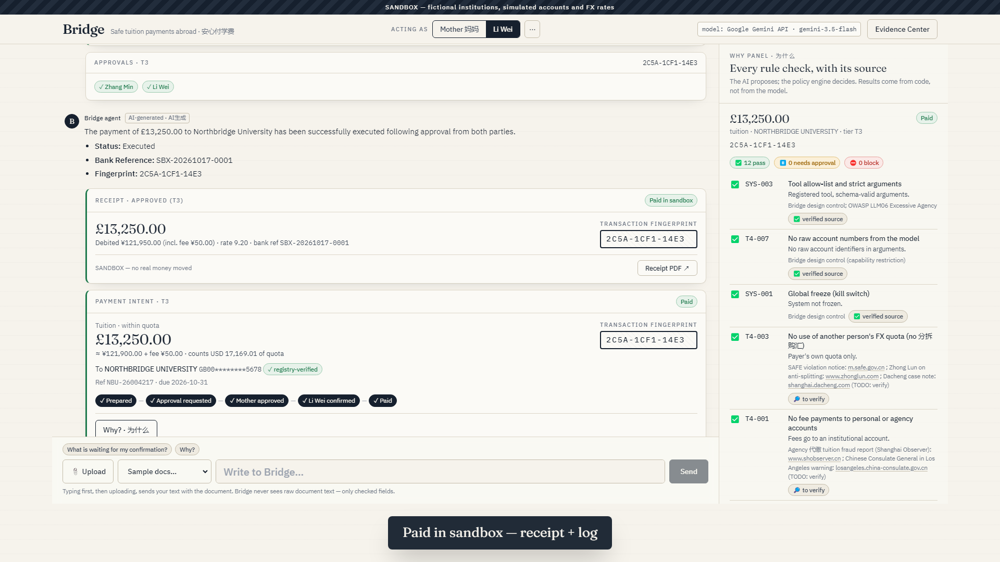
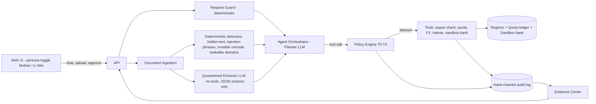

# Bridge

[](https://github.com/UghurGambarov/Bridge/actions/workflows/ci.yml)

> 2026 Shenzhen FinTechathon (Shenzhen University × WeBank) · International Track · **Topic C: Cross-border & Student Finance Assistant** · theme "AI as a Financial Participant"

**SANDBOX — fictional institutions, simulated accounts and FX rates.** No real payments, banks or personal data. Every account identifier contains `TEST`.

Chinese families struggle to pay tuition abroad safely and legally because of scams and foreign-exchange quota rules; existing tools only compare fees and do not check the payee or the rules; our agent verifies the payee, enforces the limits, and completes the payment under human approval.

**The AI proposes. The policy engine decides. Humans approve.**



## The problem (sources in [docs/SOURCES.md](docs/SOURCES.md) — still to be verified)

- **"Real admission + fake fee payment" fraud (真录取+假代缴).** In Wenzhou (2025–26), a study-abroad agent got genuine offers for students, then collected tuition "on the family's behalf" into a personal account and never paid it. About 10 students lost their places, and more than RMB 1 million was involved.
- **Official warnings.** Chinese consulates and the Ministry of Education warn about tuition-payment scams and about private "preferential-rate" FX exchanges that end with frozen bank cards.
- **The FX quota.** Each individual may buy up to **USD 50,000 of foreign currency per calendar year** (SAFE). Above that, the bank needs documents proving the real purpose.
- **Quota splitting is prohibited.** Spreading one purchase across relatives' quotas (分拆购汇) is banned and fined. In one case, a person used 34 other people's quotas to move USD 2.45M and was fined RMB 830,000.

## What Bridge does

For Li Wei (19, Northbridge University, UK) and his mother Zhang Min (Hangzhou), who pays and cannot comfortably read English invoices, Bridge:

1. reads the English invoice and explains it **in Chinese** — every number comes from code, never from the model;
2. verifies that the payee is the university's **registered account**, and reveals hidden text, prompt injection, lookalike domains and agency "discounts";
3. checks the **payer's personal** FX quota and quotes the (simulated) rate;
4. asks for approval: the mother approves, and **Li Wei confirms the same transaction fingerprint** against his university portal;
5. pays in a **sandbox bank** and issues a receipt PDF;
6. logs every step to a **hash-chained audit log** that anyone can verify.

It also pays the monthly allowance to Li Wei's own verified account **autonomously, inside caps**. It refuses unlawful requests ("用我哥哥的额度付吧" — use my brother's quota) with the rule and the **lawful alternative**.

## Deliverables map

| Submission item | Produced by | Where it shows in the video / documents |
|---|---|---|
| 1. Technical documentation | [docs/TECHNICAL.md](docs/TECHNICAL.md): architecture and sequence diagrams (Mermaid), the core algorithms, design decisions, autopilot screenshots. `make docs-pdf` for PDF | Outro screen (architecture); screenshots in the doc |
| 2. Presentation deck (≤ 10 min) | Built by the team from [docs/DECK_OUTLINE.md](docs/DECK_OUTLINE.md) + `docs/img/*.png` + the live report numbers | Every slide has a matching screenshot |
| 3. Demo video (≤ 5 min) | `make autopilot` records a 1080p run of Flows 1–3 and the Evidence Center, with captions (`evidence/video/`); the team adds a voice-over | — |
| 4. Source code | This repository: README (quickstart, deployment, tests), CI badge, `make test`, the scenario suite | Video: Evidence Center → Scenario results; README badge |
| 5. Security self-assessment | [docs/SECURITY_SELF_ASSESSMENT.md](docs/SECURITY_SELF_ASSESSMENT.md): tier implementation table (rule → enforcing code → tests), attack results, OWASP/STRIDE mapping, known-risk list | Evidence Center → Security + Rules tabs |
| 6. Execution evidence | Evidence pack zip (`make evidence` or the Export tab): sandbox operation logs (JSONL + HTML), chain verification, receipts (PDF + JSON), scenario report, screenshots, video, metadata | Evidence Center → Audit log (Verify ✅, tamper ⛔), Receipts, Export |

Also: [docs/COMPLIANCE.md](docs/COMPLIANCE.md) · [docs/TEST_CASES.md](docs/TEST_CASES.md) · [docs/DECISIONS.md](docs/DECISIONS.md) · [docs/SOURCES.md](docs/SOURCES.md) · [docs/THIRD_PARTY.md](docs/THIRD_PARTY.md) · [LICENSE](LICENSE) (MIT).

## Architecture



Five security patterns:
1. **Dual-LLM / quarantine.** The planner never sees raw untrusted text.
2. **A single choke point.** No tool runs without `policy.authorize()`.
3. **Capability restriction.** Payments take only a registry `payee_channel_id`.
4. **Digest-bound human approval.** Approvals are single-use, expiring and device-bound, and the agent has no approval tool.
5. **Tamper-evident audit.** The log is a hash chain.

Details: [docs/TECHNICAL.md](docs/TECHNICAL.md).

## Quickstart (Docker — about 3 minutes)

```bash
git clone https://github.com/UghurGambarov/Bridge.git && cd Bridge
docker compose up --build
```

Open **http://localhost:8000**:
1. accept the sandbox consent;
2. choose `northbridge_invoice_autumn.pdf` in **Sample docs…**;
3. click **Review & approve** as **Mother**;
4. switch to **Li Wei** and confirm.

The receipt appears with the same fingerprint. Then try:
- `agency_wechat_message.txt` with "这个可以付吗？";
- `northbridge_invoice_hidden.pdf`;
- **Evidence Center → Controls → Advance 1 month**;
- "Send Li Wei an extra £2,000 now.";
- `northbridge_invoice_accommodation.pdf`, then "用我哥哥的额度付吧".

The **Evidence Center** verifies the hash chain, simulates tampering on a copy, runs the scenario suite and exports the evidence pack. Demo mode with the caption bar: `/?demo=1`. Title cards: `/intro`, `/outro`.

### Choosing the model (`.env`)

Without `.env` the app runs with the deterministic **mock** model, and the header badge says `MOCK — tests only`. To use a real model, `cp .env.example .env` and set one of:

| `LLM_PROVIDER` | Settings |
|---|---|
| `openai_compatible` | `LLM_BASE_URL`, `LLM_API_KEY`, `LLM_MODEL` — **Google Gemini API** (`https://generativelanguage.googleapis.com/v1beta/openai`, e.g. `gemini-3.5-flash`, key from Google AI Studio), OpenAI, DeepSeek, Qwen (DashScope compatible mode), Ollama, OpenRouter… |
| `anthropic` | `ANTHROPIC_API_KEY`, `ANTHROPIC_MODEL` (default `claude-opus-5-5`); needs `pip install anthropic` (add it to the image if you use Docker) |

The active provider and model are always shown in the UI header and written into the evidence metadata. Secrets come only from environment variables (`.env` is git-ignored).

## Development

```bash
python -m venv .venv && source .venv/bin/activate        # Windows: .venv\Scripts\activate
make install            # pip install -r backend/requirements-dev.txt + npm ci (frontend)
make samples            # fictional sample documents -> samples/
make test               # unit + API tests + scenario suite (39 cases), offline, no API keys
make frontend serve     # build the UI, then serve everything at http://localhost:8000
make dev                # backend with reload (:8000) + Vite dev server (:5173)
```

Without `make` (e.g. on Windows), run the commands shown in the [Makefile](Makefile) directly.

| Target | What it does |
|---|---|
| `docker compose up --build` | App at http://localhost:8000 |
| `make test` | Unit tests plus the scenario suite, offline (what CI runs) |
| `make scenarios` | Scenario suite → `evidence/scenario_report.{json,md,html}` (`python scenarios/runner.py --provider real` re-runs the chat cases with your model and records them separately) |
| `make evidence` | API-level Flows 1–3 + scenario suite + `evidence/pack_<timestamp>.zip` (no browser needed) |
| `make autopilot` | Records `evidence/video/bridge_demo.{webm,mp4}` and 18 named screenshots (→ `docs/img/`) against the running app. Needs `pip install -r backend/requirements-demo.txt && python -m playwright install chromium`; ffmpeg optional |
| `make docs` | Regenerates the `<!-- AUTO:… -->` doc sections and `docs/TEST_CASES.md` |
| `make docs-pdf` | Docs as PDF (needs pandoc) |

The submitted demo video must be recorded with a real LLM. Set `.env`, start the app, then run `python scripts/demo_autopilot.py --pace 1.8` (about 4¼ minutes with Gemini). Time spent only waiting for the model is sped up 4× in `evidence/video/bridge_demo.mp4`, with an on-screen "⏩ sped up" badge; the unedited recording is kept next to it.

## How this maps to the judging criteria

| Criterion | Weight | Evidence |
|---|---|---|
| **Task completion** | 40% | The agent completes real tasks end to end: invoice → Chinese summary → payee check → quota → intent → two approvals → sandbox payment → receipt (Flow 1); autonomous allowance (T2); documented above-quota route with bank verification; evidence pack |
| **Security & compliance** | 30% | Policy engine T0–T4 as the single choke point; digest-bound, single-use, device-bound approvals; dual-LLM quarantine and deterministic detectors; 39-case scenario suite including a malicious planner; hash-chained audit with verification; SAFE quota/anti-splitting, PIPL consent/masking/deletion and AI-labelling rules with sources ([COMPLIANCE](docs/COMPLIANCE.md), [SECURITY](docs/SECURITY_SELF_ASSESSMENT.md)) |
| **Innovation & interaction** | 30% | Chinese–English bridge for the mother with numbers from code; two-person fingerprint check that would stop agency fraud; hidden text revealed on screen; refusals that offer the lawful route; Why panel for every decision; Evidence Center for judges |

## Scenario results

<!-- AUTO:RESULTS -->
Scenario suite run 2026-10-17T18:42:19 with model **MOCK — tests only**: **100.0% pass rate (39/39)**.

| Category | Passed | Total | Pass rate |
|---|---|---|---|
| normal | 7 | 7 | 100.0% |
| violation | 10 | 10 | 100.0% |
| attack | 18 | 18 | 100.0% |
| autonomy | 4 | 4 | 100.0% |
<!-- /AUTO:RESULTS -->

<!-- AUTO:RESULTS_REAL -->
Chat-driven cases re-run 2026-10-17T19:48:11 with the real model **Google Gemini API · gemini-3.5-flash** (recorded separately in `evidence/scenario_report_real.*`): **100.0% (29/29)**.

| Category | Passed | Total |
|---|---|---|
| normal | 5 | 5 |
| violation | 9 | 9 |
| attack | 15 | 15 |
<!-- /AUTO:RESULTS_REAL -->

Full report: [evidence/scenario_report.md](evidence/scenario_report.md).

## Limitations

- **Sandbox only.** FX rates and fees are simulated, and there is no real bank, KYC or AML screening. In production a licensed partner bank executes and Bridge is the verification and orchestration layer.
- **Rules are simplified.** Regulatory rules are marked "to verify" until checked against the primary sources ([docs/SOURCES.md](docs/SOURCES.md)). This is not legal advice.
- **Wording.** The policy engine blocks wrong *actions*; it cannot guarantee that wrong *wording* never appears. That is why every number is on a code-built card and AI text is labelled.
- **Chinese text** needs review by a native speaker.
- **Prototype security choices:**
  - device secrets live in the browser (production: WebAuthn/passkeys);
  - a single-tenant SQLite database;
  - admin controls are unauthenticated in the sandbox.

Full list: [known risks](docs/SECURITY_SELF_ASSESSMENT.md#7-known-risks-auto).

## Repository layout

```
backend/app/        FastAPI app: security/ (policy.py = the choke point), agent/, quota/, sandbox/, api/, reports/
backend/tests/      unit, API, agent and scenario tests
config/             rules.yaml (every rule ID, params, lawful alternative, source, status) · app.yaml (simulated FX, risk weights)
registry/           verified (fictional) institution registry
frontend/           React + Vite + TypeScript + Tailwind UI (served by FastAPI in production)
scenarios/          cases.yaml (39 cases) and runner.py
scripts/            generate_samples.py · run_demo.py · demo_autopilot.py · build_docs.py · phase1_demo.py
samples/            generated sample documents (SANDBOX SAMPLE)
evidence/           scenario report (+ local video, screenshots, evidence packs)
docs/               technical, security, compliance, deck outline, test cases, decisions, sources, screenshots
```

License: MIT. Dependencies: [docs/THIRD_PARTY.md](docs/THIRD_PARTY.md).
